  

  
  
  
  

## Hi, I'm Aarov

I build websites and the systems behind small businesses, and I'm learning in public how far one person with AI can go.

Most of what I make starts with a real business problem: product catalogues, storefronts, internal sheets and scripts, and lately AI agents that take the boring checks off people's desks. If a tool saves someone at work ten minutes a day, I count that as shipped.

## What I've built

Nine small, working tools. Each one runs in the browser with a built-in demo, and you can plug in your own Claude API key to run it live. Every repo has tests.

**Agents for real businesses**

| Project | What it does |
| :-- | :-- |
| **[TradeDesk](https://github.com/Tapovan11001/tradedesk-agent)** | Checks an export invoice against its packing list before customs does. 12 checks, a HOLD or CLEAR verdict, and one-click fixes for the maths errors. |
| **[GST Recon](https://github.com/Tapovan11001/gst-recon)** | Matches a purchase register against GSTR-2B and shows exactly which input tax credit is at risk, then drafts a follow-up email to each supplier. |
| **[Kirana Order Agent](https://github.com/Tapovan11001/kirana-order-agent)** | Turns a Hinglish WhatsApp order ("2 kilo aata, ek Maggi ka bada pack") into a priced, stock-checked cart. Also runs as an MCP server. |
| **[Shift Report](https://github.com/Tapovan11001/shift-report)** | Turns a factory's line counts into OEE numbers and a WhatsApp shift summary in Hindi or English, with the worst line first. |
| **[Padhai Quiz](https://github.com/Tapovan11001/padhai-quiz)** | Paste a chapter and get a Hindi and English practice quiz, where every answer is checked against the chapter before you see it. |

**Tools for developers**

| Project | What it does |
| :-- | :-- |
| **[TinyHarness](https://github.com/Tapovan11001/tinyharness)** | The small agent framework the other projects run on: a tool loop, budgets, a repeat guard, an approval gate and full traces, in about 600 lines you can read in one sitting. |
| **[API Test Writer](https://github.com/Tapovan11001/api-test-writer)** | Reads an OpenAPI spec and writes the tests every endpoint should pass. On the sample API, it caught both planted bugs. |

**Automations**

| Project | What it does |
| :-- | :-- |
| **[Sheet Reminders](https://github.com/Tapovan11001/sheet-reminders)** | A Google Sheets script that emails payment reminders in English or Hindi and stops the moment a row is marked Paid. |
| **[Enquiry Desk](https://github.com/Tapovan11001/enquiry-desk)** | A contact form backend that logs every enquiry to Google Sheets, sends the sender a confirmation and sorts out the spam. |

## Things I've shipped

- Shopify storefronts and Next.js marketing sites for small brands, including a designer label and an export brand
- Product catalogues and image libraries for an exporter's product ranges
- Google Sheets and scripts that run day-to-day ops: orders, stock and follow-ups

## Tools I use

  

Plus Shopify, Google Apps Script, and the Claude API for the agent work.

## Right now

- Writing agents that do one job well, and testing them properly
- Applying to summer programmes for 2027
- Looking for a **weekend remote internship** at a startup that ships fast. If that's you, email me.

Thanks for stopping by.

